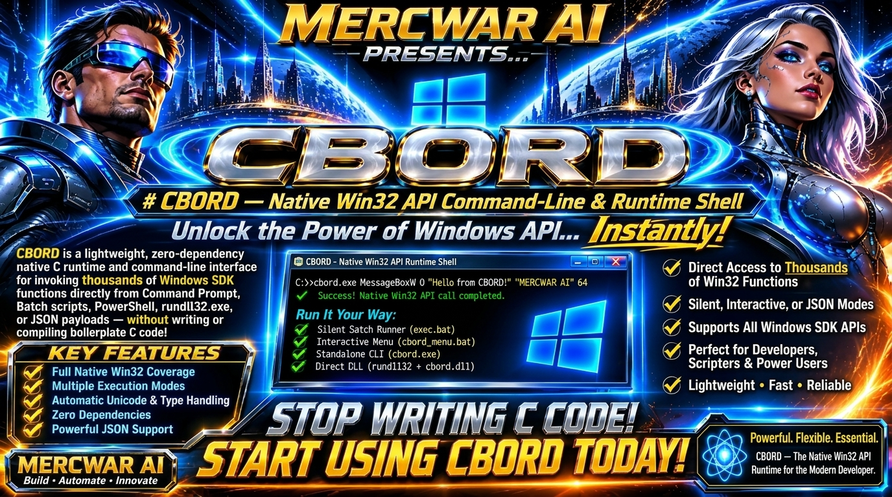
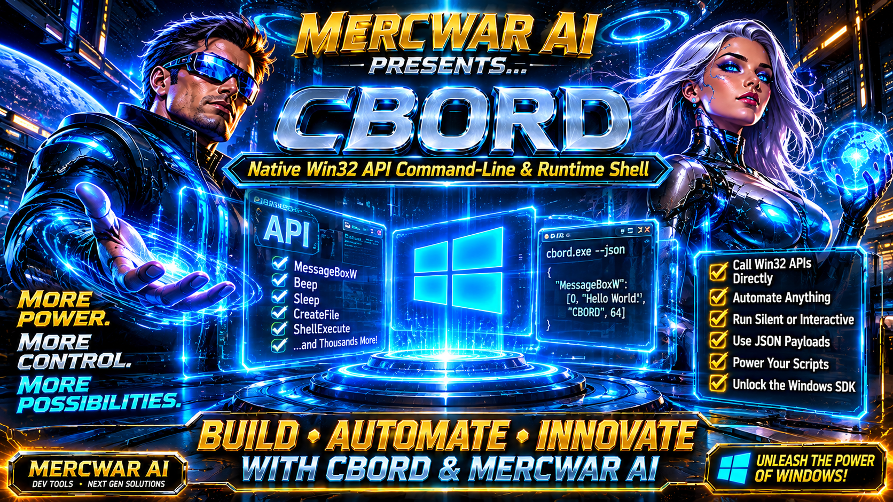

#### ⚙️ CBORD the NEW Native Win32 API Command-Line & Runtime Shell 
##### 💥 The long-awaited CYBORG HEX STRINGS!

<a target="_self" title="CLICK HERE to ENTER the GATEWAY FREE!" href="https://mercwar.github.io/Constellation/index.html">
  
</a>

#### 💡 Why CBORD?

#### *CBORD* lets you run real Windows system features—like pop-up message boxes, alert sounds, timers, and system commands—straight from a simple command line or `.bat` script, **with zero coding required**.

###### *Normally, if you want a Windows script to trigger built-in OS actions, you have to install heavy developer tools and write a full C++ program from scratch. **CBORD skips all of that.** Just type the name of the Windows action you want along with your text or numbers, and CBORD executes it instantly and silently in the background.*

---

### ✨ What You Can Do With It

- 🔹 **Instant Native Alerts:** Pop up real Windows message boxes from any `.bat` file or terminal in a single line.
- 🔹 **Silent Execution:** Play system sounds, pause timers, or trigger OS actions with zero black command windows flashing on screen.
- 🔹 **Flexible Input Modes:** Type a quick one-liner, pass a JSON snippet, or use the built-in interactive menu (`cbord_menu.bat`) so you never have to memorize commands.
- 🔹 **Zero Runtime Dependencies:** Once built, the `bin\` folder runs natively on Windows—no Python, Node.js, or .NET required.
---

#### ✨ <span style="color: #38bdf8;">Key Features</span>


- 🔹 **Full Native Win32 Coverage:** Dynamically parses Windows SDK x64 headers (`<windows.h>`) and import libraries (`kernel32`, `user32`, `gdi32`, `advapi32`, `shell32`, `ole32`, `oleaut32`, `comdlg32`, `comctl32`, `ws2_32`, `winmm`, `shlwapi`) into a binary-searchable dispatch table (`win32api.dll`).
- 🔹 **Multiple Execution Modes:**
  - ▪️ **Silent GUI/Batch Runner (`cbord.bat`):** Executes Win32 calls with zero console window flash and clean process/thread exit handling.
  - ▪️ **Interactive Menu (`menu.bat`):** Guided console interface for running custom API calls, JSON payloads, quick diagnostics, and API symbol lookups.
  - ▪️ **Native CLI Executable (`cbord.exe`):** Supports direct arguments, `--cli` mode, and `--json` mode.
  - ▪️ **Direct DLL Entry (`cbord.dll`):** Compatible with `rundll32.exe` via the exported `API` entry point.
- 🔹 **Automatic Unicode & Type Handling:** Automatically resolves `W` (Wide/UTF-16) and `A` (ANSI) function suffixes, converts quoted UTF-8 strings to `wchar_t*`, and parses integers, hex literals (`0x...`), `true`/`false`, and `null`.

---


###### "<i>I am CVBGOD, and I have given tit to you</i>!"

#### 🧩 Why CBORD Exists: Bridging the Shell and the Windows Kernel

### ✅ Steps

#####
1. Clone the REPO

```
git clone https://github.com/mercwar/CBORD
```
#####
2. Navigate to the bin folder with your command line
3. Copy one of the command lines below into your command line and press enter.


#### 💻 <span style="color: #93c5fd;">Standalone Executable (`bin\cbord.exe`)</span>

Here are the fixed and expanded test examples for your README.md, showcasing both numeric flags and the newly supported named Win32 constants (NULL, MB_OK, MB_ICONINFORMATION, MB_YESNO, MB_ICONQUESTION):
Default CLI Mode (cbord.exe):
bat

Use code with caution.
Explicit --cli Switch (cbord.exe):
bat
cbord.exe --cli MessageBoxW NULL "Explicit CLI switch!" "CBORD" "MB_YESNO|MB_ICONQUESTION"
Use code with caution.
JSON Payload Mode (--json):
bat

Use code with caution.
Batch Wrapper (cbord.bat):
bat

Use code with caution.
If you'd like me to merge these updated examples directly into your full README.md (alongside the rundll32.exe example and your copyright footer), let me know!


**Default CLI Mode:**

```bat
cbord.bat MessageBoxW NULL "Direct DLL via batch!" "CBORD" MB_OK+MB_ICONINFORMATION

```

**Explicit `--cli` Switch:** (--cli is not required and is the default)

```bat
cbord.exe MessageBoxW NULL "Default native CLI!" "CBORD" "MB_OK|MB_ICONINFORMATION"
```

**JSON Payload Mode (`--json`):**

```bat
cbord.exe --json "{\"MessageBoxW\":[0,\"JSON payload mode!\",\"CBORD\",64]}"


```

#### ⚡ <span style="color: #93c5fd;">Direct `rundll32.exe` Invocation (`bin\cbord.dll`)</span>

Invoke the exported `API` entry point directly without `cbord.exe`:

```bat
rundll32.exe "cbord.dll",API MessageBoxW NULL "Direct rundll32 call!" "CBORD" "MB_OK|MB_ICONINFORMATION"

```

For decades, Windows users and automation developers have faced a rigid divide between **command-line scripting** and **native Windows execution**. Batch scripts (`.bat`), PowerShell, and lightweight shell wrappers are fast to write and easy to automate, yet they sit outside the native Win32 subsystem. Whenever a script needs to trigger a real Windows API—whether displaying a native system dialog, playing a hardware tone, querying system state, or invoking a low-level OS routine—developers have traditionally been forced to spin up a full C/C++ project, include bulky SDK headers, manually marshal data types, and compile a dedicated executable just to make a single call.

> **CBORD eliminates that barrier**—giving shell and automation workflows direct, zero-boilerplate access to native Win32 calls.

---

#### ⚙️ How It Works Under the Hood

Instead of acting as a slow interpreter or a brittle wrapper around a handful of hardcoded functions, **CBORD** builds a direct, native bridge straight into the Windows SDK:

1. **Automated SDK Synthesis (`cbord32api.c`)**
During setup, CBORD scans the official x64 Windows SDK headers (`<windows.h>`) alongside core system import libraries (`kernel32.lib`, `user32.lib`, `gdi32.lib`, `advapi32.lib`, `shell32.lib`, `ole32.lib`, and more). It automatically extracts valid export symbols, filters out incompatible pass-by-value structures, and generates uniform, 64-bit `INT_PTR`-aligned wrapper functions inside **`win32api.dll`**, indexed by an alphabetically sorted lookup table (`win32_table.h`).
2. **Zero-Overhead Binary Dispatch (`cbord.dll`)**
At runtime, when you pass a command to CBORD, the dispatcher performs an $O(\log n)$ binary search across thousands of native Win32 entry points in microseconds. It automatically detects whether a function expects Unicode (`*W`) or ANSI (`*A`) text, converts UTF-8 command-line strings into native `wchar_t*` buffers on the fly, maps numbers, hex addresses, booleans, and `null` pointers into a clean 16-slot register array, and releases all temporary memory immediately after the OS call returns.
3. **Flexible Frontends for Every Workflow (`cbord.bat`, `cbord.exe`, `menu.bat`)**
Whether you are embedding a silent, zero-flash Win32 call inside a background Batch script via **`cbord.bat`**, feeding structured JSON payloads into **`cbord.exe --json`**, invoking **`cbord.dll`** directly through Windows' built-in `rundll32.exe`, or exploring available APIs interactively inside **`menu.bat`**, the underlying execution path remains 100% native machine code.

---

#### 🎯 Who It Is Built For

* **Batch & Shell Scripters** — Gain full access to native Windows dialogs, timers, sound, registry, and process APIs without leaving `.bat` or `.cmd` workflows.
* **Systems Integrators & Toolmakers** — Use a single, portable runtime capable of executing dynamic Win32 instructions from CLI flags or JSON configs.
* **Developers & Learners** — Inspect how Windows DLL exports, calling conventions (`WINAPI` / `__stdcall`), UTF-16 string marshaling, and `rundll32` entry points operate at the binary level.


#### 🚀 <span style="color: #38bdf8;">Usage Examples</span>




#### 🔇 <span style="color: #93c5fd;">Silent Batch Runner (`exec.bat`)</span>

Runs any Win32 API call completely silently without popping up a console window:

```bat
cbord.bat MessageBoxW NULL "Hello from native Win32!" "CBORD" "MB_YESNO|MB_ICONINFORMATION"
```
```bat
cbord.bat Beep 750 300
```
```bat
cbord.bat Sleep 1000
```

Running `cbord.bat` with **no arguments** displays the built-in usage banner and prompts to launch **`menu.bat`**.

---

#### 📋 <span style="color: #38bdf8;">Argument Passing Rules</span>

| Input Format | Parsed As | Example |
| :--- | :--- | :--- |
| `"Double-quoted text"` | `wchar_t*` (for `*W` APIs) or `char*` (for `*A` APIs), with `\n`, `\r`, `\t` unescaped | `"Line 1\nLine 2"` |
| Decimal or Hex Integer | `INT_PTR` (`int64_t`) | `0`, `64`, `0x40` |
| `true` / `false` / `null` | `1` / `0` / `0` | `true`, `null` |
| Unspecified Trailing Args | Automatically zero-padded (`0` / `NULL`) up to 16 slots | — |

---

#### 🖥️ <span style="color: #38bdf8;">Interactive Console (`cbord_menu.bat`)</span>



Run **`menu.bat`** directly ( press **`Y`** when prompted ) to access cbord:

1. 🔹 **Run Custom Win32 API Call** — Enter any function name and arguments interactively.
2. 🔹 **Run JSON Payload Call** — Test JSON-formatted Win32 calls.
3. 🔹 **Quick Diagnostics** — Instant `MessageBoxW` and `Beep` verification tests.
4. 🔹 **Search Exported Win32 APIs** — Filter generated bindings in `win32_table.h` by keyword.
5. 🔹 **Build / Rebuild Runtime** — Trigger the local build pipeline from the menu.

---

#### 🛠️ <span style="color: #38bdf8;">Quick Start</span>

#### 🔧 <span style="color: #93c5fd;">1. Build the Runtime (First-Time Setup)</span>

Requires **Visual Studio 2019/2022/2026 Build Tools (x64)** and the **Windows 10/11 SDK**.

1. Double-click **`build_win32api.bat`** (or run it from any terminal—it automatically initializes the x64 MSVC toolchain).
2. Once finished, compiled binaries are placed in `bin\`:
    - `win32api.dll`
    - `cbord.dll`
    - `cbord.exe`

*(Create your own processes for your own name space needs)*

---

<div align="left">
  <p style="color: #66ccff; letter-spacing: 2px; font-weight: bold; margin-bottom: 4px;">
    &copy; 2026 CVBGOD Systems / MERCWAR Integration Team
  </p>
  <p style="color: #ffd700; font-size: 13px; letter-spacing: 1px; margin: 2px 0;">
    All Rights Reserved.
  </p>
  <p style="color: #999999; font-size: 12px; margin-top: 4px;">
    Unauthorized use, duplication, or distribution is strictly prohibited.
  </p>
</div>
